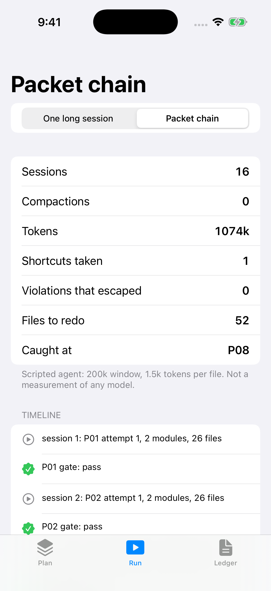
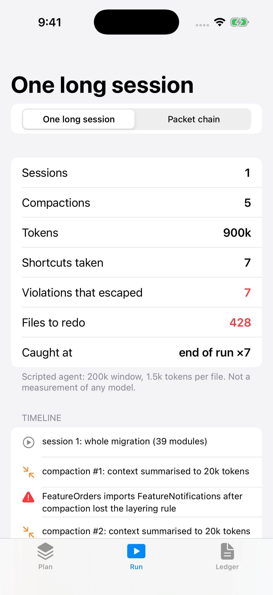
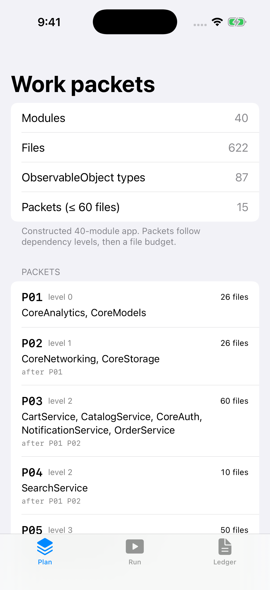
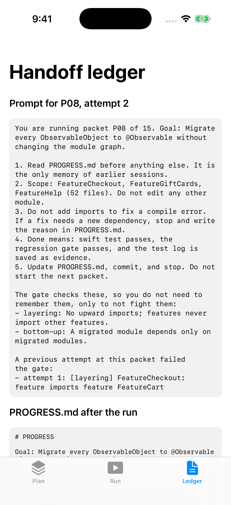

# WorkPackets

**Turn a week-long iOS migration into short, resumable, independently verifiable work packets for a coding agent.**

Article: [Coding Agents Ace the File and Fail the Week. Splitting the Week Is a Lead's Job.](https://medium.com/@er.rajatlakhina/coding-agents-ace-the-file-and-fail-the-week-splitting-the-week-is-a-leads-job-3ea81700b42f) (Medium)

Android Bench 2.0 added long-horizon tasks, the kind that take an engineer days or a week, to Google's mobile coding benchmark. The best score on them is about 28%, against about 91% on the original tasks. This repo is the lead-side answer I argue for in the article: don't wait for a model that can hold a week in its head. Decompose the week.

`WorkPackets` is a small Swift library plus a SwiftUI demo app:

| Type | What it does |
|---|---|
| `ModuleGraph` | Value-type snapshot of a module dependency graph, with deterministic topological levels and cycle detection. |
| `StructuralInvariant`, `LayerRule`, `BottomUpMigration` | The target architecture written as checks, not prose: no upward imports, no feature→feature imports, migrate bottom-up. |
| `RegressionGate` | Runs between packets. It judges the **delta** (new violations, edits outside the packet's scope, `ObservableObject` count going up), so old debt doesn't block progress. |
| `PacketPlanner` | Dependency levels first, then a file budget (default 60 files) per packet. One module bigger than the budget gets its own packet, flagged `oversize`. |
| `HandoffLedger` | The `PROGRESS.md` that survives context resets. Default-FAIL: a packet is `verified` only with a passing gate **and** recorded evidence. Round-trips through JSON. |
| `PacketPrompt` | Renders the session prompt for one packet, including findings from a failed earlier attempt. |
| `Simulator` | A **scripted** agent (200k window, 1.5k tokens per file, compaction loses the layering rule) run two ways: one long session vs a gated packet chain. |



## The numbers (constructed sample, scripted agent)

The sample is a constructed 40-module, 622-file app migrating `ObservableObject` to `@Observable`. The agent is a script, not a model, so these numbers follow from its parameters. Change them and the comparison changes.

| | One long session | Packet chain |
|---|---|---|
| Sessions | 1 | 16 (15 packets + 1 retry) |
| Compactions | 5 | 0 |
| Tokens | 900k | 1,074k (+19%) |
| Shortcuts taken | 7 | 1 |
| Violations that escaped | 7 | 0 |
| Files to redo | 428 (everything after the first bad edit) | 52 (one packet, rolled back) |
| Caught at | end of run | P08 |

With a 1M-token window the long session never compacts and takes only the one scripted shortcut, but it is still found at the end, with 348 files built on top of it (`testBiggerWindowRemovesDriftButNotLateDetection`).

```swift
let graph = SampleCodebase.graph()
let packets = try PacketPlanner(fileBudget: 60).plan(graph)
var ledger = HandoffLedger(goal: SampleCodebase.goal, packets: packets)

while let packet = ledger.nextPacket() {
    try ledger.start(packet.id)
    let before = graph
    // ... the agent works on packet.modules only ...
    let report = RegressionGate().evaluate(before: before, after: graph, scope: packet.scope)
    try ledger.record(packet.id, gate: report, evidence: [Evidence(kind: "swift test", reference: "logs/\(packet.id).txt")])
}
```

## How to run it

1. `git clone https://github.com/rajatslakhina/agent-work-packets-article-demo.git`
2. Open `Demo.xcodeproj` in Xcode.
3. Pick the `Demo` scheme and any iPhone Simulator.
4. Build & Run. There is no other setup. The app consumes the library through a local package reference to this same repo.

Launch arguments (used by CI for the screenshots): `-tab plan|run|ledger`, `-mode monolith|packets`.

Library only: `swift build && swift test` (19 XCTest cases).

## Screenshots

| One long session | Plan | Ledger |
|---|---|---|
|  |  |  |

## Verification status

- `swift build -Xswiftc -warnings-as-errors` and `swift test`: pass on Swift 6.1.2 (Linux) and on macos-15 in GitHub Actions.
- Simulator: GitHub Actions (macos-15) builds `Demo.xcodeproj` with `xcodebuild`, installs it on an iPhone Simulator, launches it four times with different launch arguments, checks the process is still alive after 8 s each time, and commits the screenshots above. Nobody tapped through the UI by hand.

## Sources

- [Android Bench 2.0: Pushing the frontier with challenging long-horizon tasks](https://android-developers.googleblog.com/2026/09/android-bench-2-long-horizon-tasks.html) (Android Developers Blog, 17 Sep 2026)
- [anthropics/cwc-long-running-agents](https://github.com/anthropics/cwc-long-running-agents) (default-FAIL results file, fresh-context evaluator, PROGRESS.md handoff)

MIT licensed.
